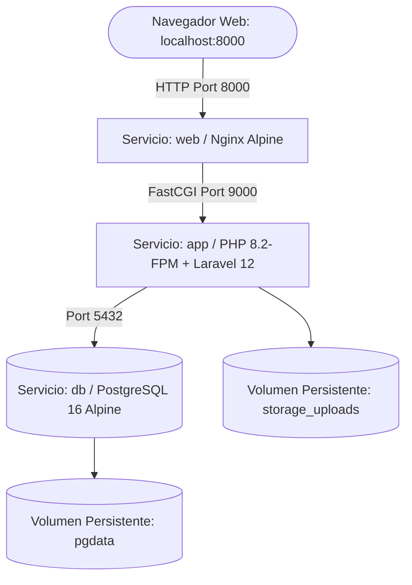

# 📋 Requerimientos del Sistema — La Petdiatría

Este documento especifica de forma exhaustiva todos los **requisitos de hardware, software, dependencias y procedimientos de configuración** necesarios para desplegar y ejecutar el sistema clínico veterinario **"La Petdiatría"** tanto en una **computadora / laptop nueva (instalación nativa)** como en un **entorno contenerizado con Docker**.

---

## 📑 Tabla de Contenidos
1. [Requisitos de Hardware](#1-requisitos-de-hardware)
2. [Requisitos de Red y Puertos](#2-requisitos-de-red-y-puertos)
3. [Modalidad A: Requisitos para Laptop / PC Nueva (Instalación Nativa)](#3-modalidad-a-requisitos-para-laptop--pc-nueva-instalación-nativa)
   - [Sistemas Operativos Compatibles](#sistemas-operativos-compatibles)
   - [Pila de Software Necesaria](#pila-de-software-necesaria)
   - [Extensiones Obligatorias de PHP 8.2](#extensiones-obligatorias-de-php-82)
   - [Paso a Paso de Instalación en Laptop Nueva](#paso-a-paso-de-instalación-en-laptop-nueva)
4. [Modalidad B: Requisitos para Entorno Docker](#4-modalidad-b-requisitos-para-entorno-docker)
   - [Software de Contenedores Requerido](#software-de-contenedores-requerido)
   - [Arquitectura de Servicios Docker](#arquitectura-de-servicios-docker)
   - [Paso a Paso de Despliegue con Docker Compose](#paso-a-paso-de-despliegue-con-docker-compose)
5. [Matriz Comparativa: Laptop Nativa vs. Docker](#5-matriz-comparativa-laptop-nativa-vs-docker)
6. [Credenciales Predeterminadas del Sistema](#6-credenciales-predeterminadas-del-sistema)
7. [Checklist de Verificación Final](#7-checklist-de-verificación-final)

---

## 1. Requisitos de Hardware

Para garantizar un rendimiento fluido del backend (Laravel 12), compilación de frontend (Vite / Tailwind CSS v4) y transacciones de base de datos (PostgreSQL 14+):

| Componente | Requisito Mínimo | Requisito Recomendado |
| :--- | :--- | :--- |
| **Procesador (CPU)** | 2 núcleos x86-64 / ARM (ej. Intel Core i3 8va gen, AMD Ryzen 3, Apple M1) | 4 núcleos o superior (Intel Core i5/i7, AMD Ryzen 5/7, Apple M1/M2/M3) |
| **Memoria RAM** | 4 GB de RAM (para instalación nativa) / 8 GB (si se usa Docker Desktop) | 8 GB a 16 GB de RAM |
| **Almacenamiento Libre** | 5 GB de espacio disponible en disco (SSD recomendado) | 10 GB a 20 GB de espacio libre en disco SSD |
| **Resolución de Pantalla** | 1280 x 720 píxeles | 1920 x 1080 (Full HD) o superior (diseño responsive compatible) |
| **Conexión a Internet** | Requerida durante la instalación para descargar paquetes (Composer, NPM, imágenes Docker) | Estable (mínimo 10 Mbps) |

> [!IMPORTANT]
> Si se utiliza **Docker Desktop en Windows**, se recomienda contar con al menos **8 GB de RAM** ya que el subsistema WSL2 reserva memoria dinámicamente para el kernel de Linux.

---

## 2. Requisitos de Red y Puertos

El sistema utiliza los siguientes puertos de red por defecto. Asegúrate de que no estén ocupados por otros servicios locales:

| Puerto | Protocolo | Servicio | Descripción |
| :---: | :---: | :--- | :--- |
| **8000** | TCP | Servidor Web / Aplicación (`php artisan serve` o Nginx) | Acceso principal a la interfaz web clínica en el navegador. |
| **5432** | TCP | PostgreSQL Database Server | Comunicación entre Laravel y el motor de base de datos relacional. |
| **5173** | TCP | Servidor de desarrollo Vite (*opcional*) | Hot Module Reloading (HMR) durante desarrollo frontend activo. |

---

## 3. Modalidad A: Requisitos para Laptop / PC Nueva (Instalación Nativa)

### Sistemas Operativos Compatibles
* **Windows:** Windows 10 (64 bits) build 19041 o superior / Windows 11.
* **Linux:** Ubuntu 20.04 / 22.04 / 24.04 LTS, Debian 11/12, Fedora, Arch Linux.
* **macOS:** macOS 12 (Monterey), 13 (Ventura), 14 (Sonoma) o superior.

---

### Pila de Software Necesaria

1. **PHP:** Versión **8.2** o superior (8.2.x o 8.3.x).
2. **PostgreSQL:** Versión **14.x**, **15.x**, **16.x** o **18.x**.
3. **Composer:** Versión **2.x** (Gestor de dependencias de PHP).
4. **Node.js:** Versión **18.x LTS** o **20.x LTS**.
5. **NPM:** Versión **9.x** o **10.x** (incluido automáticamente con Node.js).
6. **Git:** Versión **2.30+** (para clonación y control de versiones).
7. **Navegador Web Moderno:** Google Chrome, Mozilla Firefox, Microsoft Edge, Brave o Safari.

---

### Extensiones Obligatorias de PHP 8.2

En una instalación limpia de PHP (especialmente en Windows o XAMPP), **la mayoría de las extensiones vienen comentadas (desactivadas) por defecto**. 

Para que PHP pueda comunicarse con **PostgreSQL** y ejecutar las librerías del sistema, es **estrictamente obligatorio editar el archivo `php.ini` y remover el punto y coma (`;`) inicial** de las líneas correspondientes.

---

#### 🔧 Paso a Paso: Cómo habilitar las extensiones en `php.ini` (Quitar el `;`)

##### 1. Localizar el archivo `php.ini` activo en tu equipo
Abre una terminal (PowerShell o CMD) y escribe:
```bash
php --ini
```
Busca la línea **`Loaded Configuration File`**. Esa ruta indica el archivo exacto que debes abrir (por ejemplo: `C:\php\php.ini` o `C:\xampp\php\php.ini`).

> [!TIP]
> Si en la carpeta de PHP solo ves los archivos `php.ini-development` o `php.ini-production`, copia uno de ellos y renómbralo exactamente como **`php.ini`**.

##### 2. Comprender el papel del punto y coma (`;`)
En la sintaxis de configuración de PHP, **el punto y coma (`;`) al inicio de una línea significa "comentario" o función deshabilitada**. 
* Con `;` al inicio ➔ La extensión está **APAGADA**.
* Sin `;` al inicio ➔ La extensión está **ENCENDIDA / ACTIVA**.

##### 3. Descomentar las extensiones necesarias
Abre tu `php.ini` con un editor de texto (Bloc de notas, VS Code, etc.), presiona `Ctrl + F` (buscar) y localiza las siguientes líneas:

```ini
; ==============================================================================
; ❌ ANTES (Deshabilitadas por defecto con punto y coma ';')
; Si intentas conectar a PostgreSQL así, obtendrás: "could not find driver"
; ==============================================================================
;extension=pdo_pgsql
;extension=pgsql
;extension=intl
;extension=fileinfo
;extension=gd
;extension=mbstring
;extension=openssl
;extension=curl
;extension=zip

; ==============================================================================
;  DESPUÉS (Correcto: eliminando el ';' al puro inicio de cada línea)
; ==============================================================================
extension=pdo_pgsql
extension=pgsql
extension=intl
extension=fileinfo
extension=gd
extension=mbstring
extension=openssl
extension=curl
extension=zip
```

> [!WARNING]
> **Errores comunes si no quitas el punto y coma (`;`):**
> * Si olvidas quitar el `;` en `extension=pdo_pgsql` y `extension=pgsql`, Laravel arrojará el error:  
>   `SQLSTATE[08006] / could not find driver (Connection: pgsql)`.
> * Si olvidas quitar el `;` en `extension=intl`, Laravel 12 fallará al formatear números con el error:  
>   `The "intl" PHP extension is required to use the [format] method`.

##### 4. Verificar que las extensiones estén activas
Guarda los cambios en el archivo `php.ini` y ejecuta en tu terminal:

* **En Windows (PowerShell / CMD):**
  ```powershell
  php -m | findstr -i "pgsql intl gd"
  ```
* **En Linux / macOS:**
  ```bash
  php -m | grep -E "pdo_pgsql|pgsql|intl|gd"
  ```

Si en la salida de la consola aparecen `pdo_pgsql`, `pgsql` e `intl`, tu entorno PHP está correctamente configurado para trabajar con PostgreSQL.

---

#### 📋 Tabla de Justificación Técnica de Extensiones

| Extensión PHP | Justificación Técnica en "La Petdiatría" |
| :--- | :--- |
| `pdo_pgsql` / `pgsql` | **Obligatoria:** Conector nativo de bajo nivel entre Eloquent ORM y el servidor PostgreSQL. |
| `intl` | **Obligatoria:** Requerido por Laravel 12 para dar formato a importes en Guaraníes (Gs.), fechas en español y métricas. |
| `mbstring` | Manejo seguro de caracteres multilingües UTF-8 (nombres con tildes, caracteres especiales clínicos). |
| `openssl` | Cifrado seguro de sesiones, tokens CSRF y hashing de contraseñas de usuarios con algoritmo Bcrypt. |
| `curl` | Solicitudes HTTP a APIs externas y verificación de red. |
| `gd` | Procesamiento y compresión de las fotografías de perfil de las mascotas. |
| `dom` / `xml` | Renderizado y compilación de recetas médicas, carnets y facturas PDF vía `DomPDF`. |
| `fileinfo` | Validación estricta de tipos MIME en formularios de subida (evita subir archivos no permitidos). |
| `zip` | Instalación, empaquetado y actualización de librerías mediante Composer. |

---

### Paso a Paso de Instalación en Laptop Nueva

#### Paso 1: Clonar el proyecto
```bash
git clone https://github.com/TU_USUARIO/TU_REPOSITORIO.git
cd "mi-proyecto clone"
```

#### Paso 2: Instalar dependencias de PHP y Node.js
```bash
composer install
npm install
```

#### Paso 3: Configurar variables de entorno (`.env`)
```bash
cp .env.example .env
php artisan key:generate
```

Editar el archivo `.env` con las credenciales de tu PostgreSQL local:
```ini
DB_CONNECTION=pgsql
DB_HOST=127.0.0.1
DB_PORT=5432
DB_DATABASE=veterinaria
DB_USERNAME=postgres
DB_PASSWORD=tu_contraseña
```

#### Paso 4: Crear la base de datos y migrar tablas con datos iniciales
En tu consola PostgreSQL o pgAdmin, asegúrate de que la base de datos `veterinaria` esté creada:
```sql
CREATE DATABASE veterinaria;
```
Luego ejecuta las migraciones y seeders de Laravel:
```bash
php artisan migrate:fresh --seed
```

#### Paso 5: Aplicar vistas, procedimientos almacenados y triggers en PostgreSQL
Ejecuta el script SQL oficial incluido en el proyecto:
```bash
# Desde psql:
psql -U postgres -d veterinaria -f database/sql/procedimientos_triggers_consultas.sql
```
*(También puedes abrir el archivo database/sql/procedimientos_triggers_consultas.sql en pgAdmin / DBeaver y ejecutarlo en la base de datos `veterinaria`).*

#### Paso 6: Crear el enlace simbólico para imágenes
```bash
php artisan storage:link
```

#### Paso 7: Compilar los assets del frontend (Tailwind CSS v4 + Alpine.js)
```bash
npm run build
```

#### Paso 8: Iniciar el servidor local
```bash
php artisan serve --host=0.0.0.0 --port=8000
```
*Abrir en el navegador:* `http://localhost:8000`

---

## 4. Modalidad B: Requisitos para Entorno Docker

El despliegue con Docker permite levantar la aplicación, el servidor web Nginx y el motor de base de datos PostgreSQL en cuestión de minutos sin tener que instalar PHP ni PostgreSQL directamente en el sistema operativo anfitrión.

### Software de Contenedores Requerido
* **Docker Engine:** Versión **24.0+** o superior.
* **Docker Compose:** Versión **v2.20+** (sintaxis `docker compose`).
* **En Windows/Mac:** **Docker Desktop** con motor WSL2 (Windows Subsystem for Linux 2) habilitado y activo.
* **Virtualización CPU:** Habilitada en la BIOS/UEFI de la máquina (Intel VT-x o AMD-V).

---

### Arquitectura de Servicios Docker



El stack Docker se compone de tres contenedores interconectados:
1. **`app` (PHP 8.2-FPM):** Contenedor con Laravel 12, extensiones PHP preconfiguradas (`pdo_pgsql`, `intl`, `gd`, etc.) y Composer.
2. **`web` (Nginx):** Servidor web de alto rendimiento encargado de enrutar el tráfico HTTP y servir archivos estáticos.
3. **`db` (PostgreSQL 16):** Base de datos oficial con persistencia en un volumen de Docker (`pgdata`).

---

### Paso a Paso de Despliegue con Docker Compose

#### Paso 1: Configurar el archivo de entorno Docker
Copia el archivo base:
```bash
cp .env.example .env
```
Ajusta la sección de base de datos en `.env` para que apunte al contenedor `db`:
```ini
DB_CONNECTION=pgsql
DB_HOST=db
DB_PORT=5432
DB_DATABASE=veterinaria
DB_USERNAME=postgres
DB_PASSWORD=postgres_password_2026
```

#### Paso 2: Construir e iniciar los contenedores
```bash
docker compose up -d --build
```

#### Paso 3: Inicializar la aplicación dentro del contenedor
Ejecuta los siguientes comandos una sola vez:
```bash
# 1. Generar la clave de cifrado
docker compose exec app php artisan key:generate

# 2. Ejecutar migraciones con usuarios y catálogos de prueba
docker compose exec app php artisan migrate:fresh --seed

# 3. Vincular el directorio de fotos y recetas
docker compose exec app php artisan storage:link

# 4. Compilar assets frontend
docker compose exec app npm run build
```

#### Paso 4: Cargar vistas, procedimientos y triggers en la base de datos
```bash
docker compose exec -T db psql -U postgres -d veterinaria < database/sql/procedimientos_triggers_consultas.sql
```

#### Paso 5: Acceder al sistema
Abre tu navegador en:
```text
http://localhost:8000
```

---

## 5. Matriz Comparativa: Laptop Nativa vs. Docker

| Criterio | Laptop Nueva (Bare Metal) | Entorno Docker |
| :--- | :--- | :--- |
| **Tiempo de configuración inicial** | 20 - 35 minutos (instalando PHP, Postgres, extensiones) | 5 - 10 minutos (un solo comando `docker compose up`) |
| **Aislamiento de versiones** | Las versiones de PHP y Postgres afectan todo el sistema | 100% aislado en contenedores independientes |
| **Consumo de Memoria RAM** | Menor consumo (PHP y Postgres corren como servicios nativos) | Requiere ~1.5 GB a 2 GB adicionales para el motor Docker |
| **Facilidad para compartir en equipo** | Requiere que cada miembro instale y configure las mismas versiones | Idéntico en cualquier PC con Docker instalado |
| **Ideal para** | Desarrollo diario rápido, laptops con pocos recursos (4 GB RAM) | Demostraciones, evaluaciones universitarias, servidores VPS |

---

## 6. Credenciales Predeterminadas del Sistema

El sistema viene precargado con cuentas para todos los perfiles clínicos y operativos:

| Rol | Usuario | Contraseña | Funcionalidad Principal |
| :--- | :---: | :---: | :--- |
| **Super Administrador** | `admin` | `12345678` | Gestión total, roles, permisos y configuración clínica. |
| **Veterinario Principal** | `jperez` | `12345678` | Consultas, atenciones médicas, recetas PDF y agenda. |
| **Recepción** | `mlopez` | `12345678` | Registro de pacientes/clientes, citas y cobro en caja. |
| **Estética y Peluquería** | `pfernandez` | `12345678` | Servicios de SPA, baños y tratamientos de peluquería. |

---

## 7. Checklist de Verificación Final

Antes de presentar o poner en marcha el sistema, verifica que cada ítem esté completado:

- [ ] El motor de base de datos PostgreSQL está activo y la base de datos `veterinaria` existe.
- [ ] La extensión `intl` de PHP está habilitada (`php -m | grep intl`).
- [ ] Las migraciones y datos iniciales fueron cargados (`php artisan migrate:fresh --seed`).
- [ ] El script de funciones y triggers está ejecutado (`database/sql/procedimientos_triggers_consultas.sql`).
- [ ] El enlace simbólico de almacenamiento existe (`php artisan storage:link`).
- [ ] Los assets frontend están compilados (`npm run build`).
- [ ] Se puede iniciar sesión con el usuario `admin` y contraseña `12345678`.
- [ ] Las suites de pruebas automatizadas pasan al 100% (`php artisan test --filter=Mejoras`).
